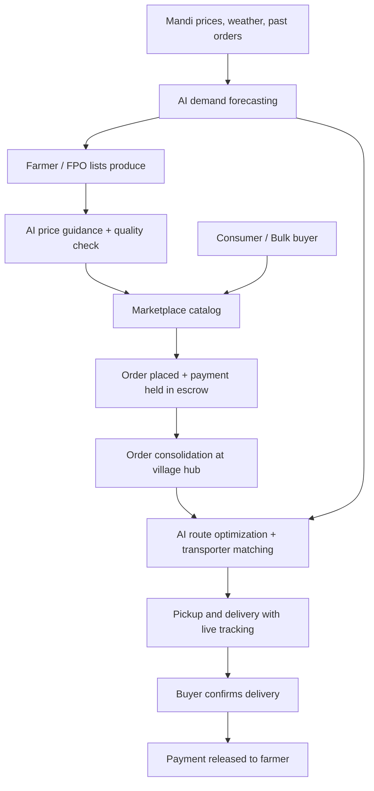

# Smart India Hackathon Workshop
# Date: 27/10/2026
## Reference Number: 26017383
## Name: Yuvan Shankar Ram K.R

## Problem Title
SIH 26033: Multiple intermediaries reduce farmers earnings and increase consumer prices.

## Problem Creater's Organization
Ministry of Consumer Affairs, Food & Public Distribution

## Theme
Agriculture, FoodTech & Rural Development

## Problem Description
Expected Solution: Create a digital marketplace that:

• Connects farmers/FPOs directly with consumers and bulk buyers.
• Provides logistics support.
• Uses AI for demand forecasting and route optimization.

Benefits:

• Better prices for farmers.
• Lower prices for consumers.
• Reduced supply chain inefficiencies.

## Proposed Solution

### 1. Detailed explanation of the proposed solution

**KisanSetu** (working name) is a farm-to-buyer digital marketplace available as a mobile app and web portal, with voice and regional-language support. It has four connected parts:

- **Direct marketplace:** Farmers and Farmer Producer Organizations (FPOs) list produce with quantity, grade, harvest date, location and photos. Consumers, retailers, restaurants, hostels and bulk buyers browse, order, or place bulk bids and subscriptions (for example, weekly vegetable boxes).
- **Logistics support:** Orders are consolidated at village-level collection points or FPO hubs. Partner transporters and local delivery agents are matched automatically, with cold-chain options for perishables and live shipment tracking.
- **AI engine:** Demand forecasting predicts what buyers will need by crop, area and season. Route optimization groups pickups and deliveries to cut cost and spoilage. Price guidance shows farmers a fair price range based on mandi rates, demand and quality.
- **Trust and payments:** Aadhaar or FPO-based farmer verification, quality grading with ratings, escrow-style UPI payments released on delivery, and a dispute-resolution flow.

### 2. How it addresses the problem

| Problem today | How the platform addresses it |
|---|---|
| Many middlemen take a margin at each step | Farmers and buyers trade directly; only a small, transparent platform and logistics fee remains |
| Farmers lack price information and bargaining power | Live mandi price comparison, AI price guidance, and bulk-bid options |
| Consumers pay inflated retail prices | Shorter supply chain lowers the final price and gives fresher produce |
| Produce is wasted due to poor planning and delays | Demand forecasts guide what to sell and when; optimized routes cut transit time |
| Small farmers cannot reach large buyers | FPO aggregation lets small lots be pooled into bulk orders |
| Delayed or uncertain payment | Digital payments with guaranteed settlement soon after delivery |

### 3. Innovation and uniqueness of the solution

- **Demand-first planning:** AI forecasts shared with farmers and FPOs before sowing and harvest, not only after produce is ready.
- **Integrated logistics, not just a listing site:** Collection hubs, pooled pickups and route optimization are built into the order flow.
- **Built for rural users:** Voice-based listing, regional languages, low-bandwidth mode and an offline-first approach with SMS fallback.
- **Transparent price breakup:** Every order shows the farmer's share, logistics cost and platform fee.
- **Government integration potential:** Can plug into e-NAM, Agmarknet price data and FPO registries, and support public procurement and distribution needs.

---

## Technical Approach

### 1. Technologies to be used

| Layer | Technologies |
|---|---|
| Frontend (web) | React.js, Tailwind CSS |
| Mobile app | Flutter or React Native, with multilingual and voice input (speech-to-text) |
| Backend | Node.js (Express) or Python (FastAPI), REST APIs |
| Database | PostgreSQL (orders, users, listings), MongoDB (catalog, logs), Redis (caching) |
| AI / ML | Python, scikit-learn, Prophet / LSTM for demand and price forecasting; Google OR-Tools for route optimization (vehicle routing) |
| Maps and tracking | OpenStreetMap / Google Maps API, GPS tracking |
| Payments | UPI / Razorpay-style gateway with escrow-style settlement |
| Notifications | SMS, WhatsApp / push notifications |
| Cloud and DevOps | AWS / Azure or MeitY-empanelled cloud, Docker, GitHub Actions CI/CD |
| Data sources | Agmarknet / e-NAM mandi prices, weather APIs, historical sales data |
| Security | JWT authentication, role-based access control, HTTPS, data encryption |

### 2. Methodology and process for implementation

**System flow**

**Implementation phases**

1. **Requirement study:** Survey farmers, FPOs, buyers and transporters; map the current supply chain and middleman margins.
2. **Design:** User flows, database schema, API design and a multilingual UI prototype.
3. **MVP build:** Farmer onboarding, product listing, ordering, payments and an admin dashboard.
4. **AI modules:** Train demand and price forecasting models on historical mandi data; build the route optimization service.
5. **Logistics integration:** Onboard transporters, set up collection hubs and enable live tracking.
6. **Pilot:** Launch in one district with a few FPOs and local buyers; collect feedback and measure farmer income and price changes.
7. **Scale-up:** Expand to more crops, regions and bulk or institutional buyers.

---

## Feasibility and Viability

### 1. Analysis of the feasibility of the idea

- **Technical:** All components (marketplace, payments, forecasting, route optimization) use mature, widely available technologies and open datasets.
- **Operational:** FPOs already aggregate produce, which makes village hubs and pooled pickups practical.
- **Economic:** Revenue can come from a small commission, logistics margin, and premium services such as analytics and subscriptions. Cutting middlemen leaves room for a lower fee than the current margins.
- **Policy fit:** Aligns with national initiatives such as e-NAM, FPO promotion, UPI and Digital India.

### 2. Potential challenges and risks

- Low digital literacy and patchy internet in rural areas
- Farmer and buyer trust in a new platform
- Last-mile logistics cost and cold-chain availability
- Quality inconsistency and order disputes
- Chicken-and-egg problem: enough buyers and sellers are needed at the same time
- Forecast accuracy affected by weather and market volatility
- Data privacy and payment security

### 3. Strategies for overcoming these challenges

| Challenge | Strategy |
|---|---|
| Low digital literacy | Voice-based, regional-language UI; "Krishi Mitra" local agents and FPO staff to assist onboarding |
| Poor connectivity | Offline-first app, SMS / IVR fallback |
| Trust | Verified profiles, ratings, escrow payments, government and FPO partnerships |
| Logistics cost | Pooled pickups, route optimization, shared transport, hub-and-spoke model |
| Quality disputes | Standard grading, photo evidence at pickup, rating and dispute resolution flow |
| Cold start | Pilot in one district with anchor buyers (hostels, restaurants, retailers) and a few FPOs |
| Forecast uncertainty | Continuously retrain models with weather and live market data; show confidence ranges |
| Security | Encryption, role-based access, regular audits, compliance with data protection rules |

---

## Impact and Benefits

### 1. Potential impact on the target audience

- **Farmers and FPOs:** Higher share of the final price, faster payment, better planning from demand forecasts and access to larger markets.
- **Consumers:** Fresher produce at lower prices with transparent pricing.
- **Bulk buyers (retailers, restaurants, institutions):** Reliable supply, consistent quality and simple bulk ordering.
- **Transporters and local agents:** More consistent work through optimized, consolidated routes.
- **Government:** Better visibility of supply, demand and prices to support food security and policy decisions.

### 2. Benefits of the solution

- **Social:** Empowers small and marginal farmers, creates rural jobs (agents, hub operators, drivers) and increases digital inclusion.
- **Economic:** Higher farmer incomes, lower consumer prices and reduced supply chain inefficiencies.
- **Environmental:** Less food waste, fewer wasted trips through route optimization and lower transport emissions.

---

## Research and References

1. Smart India Hackathon, Problem Statement SIH 26033, Ministry of Consumer Affairs, Food & Public Distribution
2. e-NAM (National Agriculture Market): https://enam.gov.in
3. Agmarknet (agricultural market price data): https://agmarknet.gov.in
4. FPO scheme, Ministry of Agriculture & Farmers Welfare: https://agricoop.nic.in
5. NPCI, Unified Payments Interface (UPI): https://www.npci.org.in
6. Google OR-Tools, Vehicle Routing Problem: https://developers.google.com/optimization/routing
7. Prophet, time-series forecasting library: https://facebook.github.io/prophet/

## Research and References
Remove These Lines
1. Details / Links of the reference and research work
